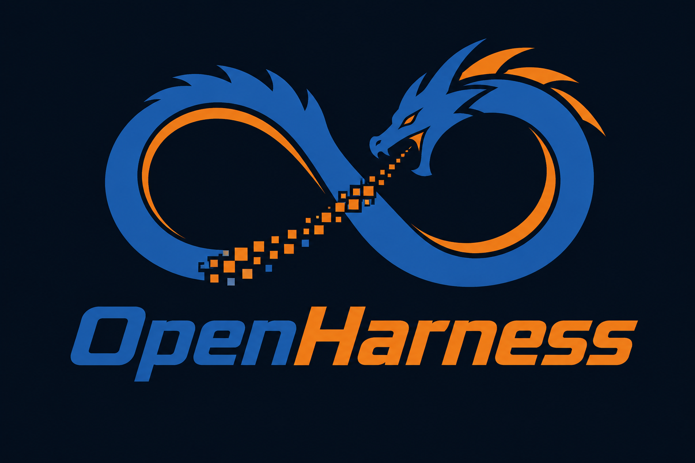

**A lightweight, extensible AI harness.**

OpenHarness is an experimental AI harness designed to connect LLMs with tools, filesystem access, and a customizable execution environment.


## Features

- **LLM Integration** – Connect to models through Any Tested AI Provider like OpenRouter.
- **Tool Registry** – Register and execute custom Python functions.
- **Filesystem Access** – Read, write, and list files inside a dedicated workspace.
- **Function Calling** – Let the AI decide when to use available tools.
- **Reasoning Support** – Enable reasoning through compatible models.
- **Conversation History** – Maintain context throughout a conversation.
- **Configurable** – Manage API credentials, model selection, and debug settings through JSON configuration.

## Project Structure

```text
OpenHarness/
├── config/
│   └── config.json
├── src/
│   └── openharness/
│       ├── __init__.py
│       └── tools/
│           ├── __init__.py
│           ├── filesystem.py
│           └── registry.py
├── .venv/
└── README.md
```

## Requirements

- Python 3.9+
- UV
- An API key
- Internet connection

### Dependencies

```bash
pip install requests
```

## Installation

Clone the repository:

```bash
git clone https://github.com/USERNAME/OpenHarness.git
cd OpenHarness
```

Create a virtual environment:

```bash
python -m venv .venv
```

Activate it on Windows:

```powershell
.venv\Scripts\activate
```

Install dependencies:

```bash
pip install requests
```

## Configuration

Generate the default configuration:

```bash
python src/openharness/__init__.py generate config
```

Edit `config/config.json`:

```json
{
    "API_URL": "https://openrouter.ai/api/v1/chat/completions",
    "API_KEY": "YOUR_OPENROUTER_API_KEY",
    "MODEL": "nvidia/nemotron-3.5-super-vl:free",
    "DEBUG": false
}
```

| Setting | Description |
|---|---|
| `API_URL` | OpenRouter API endpoint |
| `API_KEY` | Your OpenRouter API key |
| `MODEL` | Model identifier |
| `DEBUG` | Enables or disables debug output |

**Security:** Never commit your API key. Add `config/config.json` to `.gitignore`.

## Usage

Start OpenHarness:

```powershell
openharness.bat
```

Once running, you can communicate with the model through the terminal.

Example:

```text
OpenHarness v0.1
----------------

You: Create an HTML file called index.html

[Tool] Calling: write_file
[Tool] Result: null

OpenHarness: Created index.html!
```

## Built-in Tools

OpenHarness currently includes filesystem tools.

| Tool | Description |
|---|---|
| `read_file` | Reads a file from the workspace |
| `write_file` | Creates or modifies a file |
| `list_files` | Lists files in the workspace |

All filesystem operations are restricted to the configured workspace.

## Commands

| Command | Description |
|---|---|
| `/exit` | Exit OpenHarness |
| `/clear` | Clear conversation history |
| `/help` | Display help information (if implemented) |

## Architecture

OpenHarness uses a simple tool-calling architecture:

```text
              User
               |
               v
         OpenHarness CLI
               |
               v
          Chat Handler
               |
               v
          AI Provider
               |
               v
          Language Model
               |
          +----+----+
          |         |
       Response   Tool Call
          |         |
          v         v
        User    Tool Registry
                    |
                    v
               Tool Execution
                    |
                    v
                 Workspace
```

The model decides when a registered tool is needed. OpenHarness executes the requested function and sends its result back to the model.

## Development

OpenHarness is currently in early development.

Planned improvements may include:

- More built-in tools.
- Terminal command execution.
- Tool permissions and approval system.
- Improved conversation management.
- Multiple LLM providers.
- Plugin and extension support.
- Better logging and debugging.

## License

License: To be determined.

---

**OpenHarness** — Connecting language models to the tools they need.